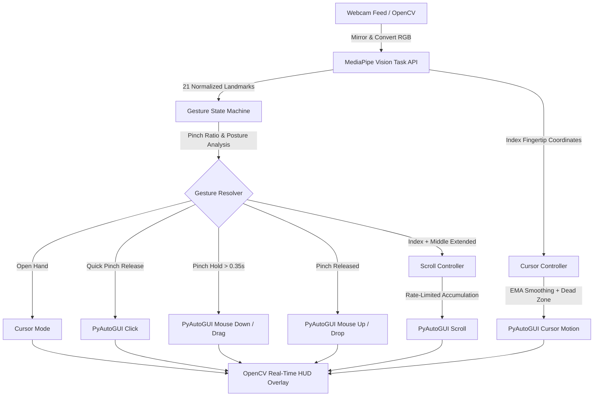

<div align="center">

# 🖐️ AirControl

### **Next-Generation Real-Time Touchless Hand Gesture Computer Controller**

[](https://www.python.org/downloads/)
[](https://ai.google.dev/edge/mediapipe/solutions/guide)
[](https://opencv.org/)
[](LICENSE)

*AirControl is an advanced, touchless human-computer interface (HCI) software that maps physical hand gestures captured by standard webcams into precise OS cursor navigation, mouse clicks, drag-and-drop actions, and smooth document scrolling.*

---

</div>

## 🌟 Key Features

- 🎯 **Jitter-Free Precision Tracking**: Employs Exponential Moving Average (EMA) smoothing (`alpha=0.25`) combined with a dynamic dead-zone threshold (`4.0px`) to eliminate high-frequency hand tremors.
- 📐 **Adaptive Active Region Mapping**: Custom active region bounding box mapped seamlessly to your full OS screen resolution, avoiding physical strain at camera edges.
- 🤏 **Normalized Scale-Invariant Pinch Engine**: Distance ratio between Index tip and Thumb tip relative to hand size (Wrist to Middle MCP), rendering gesture recognition robust to hand depth/distance from camera.
- 🖱️ **Full Mouse Functionality**:
  - **Cursor Movement**: Smooth continuous tracking of the index fingertip.
  - **Left Click**: Quick pinch & release action.
  - **Drag-and-Drop**: Hold pinch beyond `0.35s` or `25px` movement to engage mouse down; release pinch to drop.
  - **Two-Finger Scroll**: Extended Index & Middle finger posture triggers rate-limited vertical scrolling.
- ❄️ **Anti-Jump Cursor Freeze**: Automatically anchors cursor position during click evaluation and scrolling to prevent unintentional target drift.
- 🖥️ **Real-Time Heads-Up Display (HUD)**: Interactive visual feedback with bounding boxes, landmark skeleton overlays, FPS counter, pinch ratio stats, and dynamic action flash indicators.
- ⚡ **Hot-Swappable Runtime Controls**: Instantly toggle individual controllers (Cursor, Clicks/Drag, Scroll) on the fly using keyboard shortcuts.

---

## 🏗️ System Architecture & Workflow

AirControl operates via a modular design separating vision processing, spatial coordinate mapping, gesture state transitions, and OS mouse synthetic event dispatching.



---

## 📁 Repository Structure

```
AirControl/
│
├── models/
│   └── hand_landmarker.task   # Pre-trained MediaPipe 21-landmark model bundle
│
├── src/
│   ├── main.py                # Pipeline orchestrator, webcam loop & HUD GUI
│   ├── cursor_controller.py   # Coordinate interpolation, EMA smoothing & active region mapping
│   ├── gesture_detector.py    # Gesture state machine (PinchState) & posture detection
│   └── scroll_controller.py   # Rate-limited vertical scroll velocity engine
│
├── .gitignore                 # Environment and temporary file exclusions
├── requirements.txt           # Python library dependencies
└── README.md                  # Project documentation
```

---

## ⚡ Getting Started

### Prerequisites

- **Python**: Version 3.10 or higher
- **Webcam**: Built-in or external USB camera

### Installation

1. **Clone the Repository**:
   ```bash
   git clone https://github.com/AyushKumar-alt/Air-Control.git
   cd Air-Control
   ```

2. **Create a Virtual Environment** *(Recommended)*:
   ```bash
   python -m venv .venv
   
   # Windows PowerShell:
   .\.venv\Scripts\Activate.ps1
   
   # Linux / macOS:
   source .venv/bin/activate
   ```

3. **Install Dependencies**:
   ```bash
   pip install -r requirements.txt
   ```

---

## 🚀 Usage

Run the main application script:

```bash
python src/main.py
```

Position your hand in front of the camera inside the green **ACTIVE REGION** box.

### 🎮 Keyboard Shortcuts

| Key | Action | Description |
| :---: | :--- | :--- |
| `C` | **Toggle Cursor** | Enable or disable mouse cursor movement. |
| `P` | **Toggle Click / Drag** | Enable or disable click and drag-and-drop interactions. |
| `S` | **Toggle Scroll** | Enable or disable two-finger scroll mode. |
| `Q` | **Quit** | Gracefully terminate the application and release hardware resources. |

---

## 🖐️ Gesture Guide

| Gesture | Hand Posture | Action Triggered | Visual Indicator |
| :--- | :--- | :--- | :--- |
| **Cursor Motion** | Open hand, index finger pointing | Moves OS mouse cursor smooth across screen | `Mode: CURSOR` |
| **Left Click** | Quick pinch between Thumb (#4) and Index (#8) | Single Left Mouse Click | `*** LEFT CLICK ***` |
| **Drag & Drop** | Pinch Thumb & Index and hold for > 0.35s | Holds Left Mouse Button down; move hand to drag, release pinch to drop | `*** DRAGGING ***` / `*** DROP ***` |
| **Scroll Up / Down** | Extend Index (#8) & Middle (#12) fingers, fold Ring & Pinky | Scrolls viewport UP when hand moves up, DOWN when hand moves down | `SCROLL UP` / `SCROLL DOWN` |

---

## ⚙️ Configuration & Tuning

You can easily adjust control parameters directly in [`src/main.py`](file:///c:/Users/calpo/OneDrive/Documents/AirControl/src/main.py#L59-L81):

```python
# Cursor Sensitivity & Smoothing
cursor_controller = CursorController(
    margin_x=60,       # Horizontal margin box padding (px)
    margin_y=40,       # Vertical margin box padding (px)
    alpha=0.25,        # EMA smoothing factor (lower = smoother, higher = faster response)
    dead_zone=4.0      # Sub-pixel movement noise suppression threshold
)

# Gesture Pinch Sensitivity
gesture_detector = GestureDetector(
    activation_threshold=0.28,  # Pinch ratio to trigger pinch state
    release_threshold=0.38,     # Pinch ratio to register release
    drag_hold_time=0.35,        # Seconds before click turns into drag
    drag_move_threshold=25.0    # Distance moved (px) before drag engages
)

# Scroll Sensitivity
scroll_controller = ScrollController(
    movement_threshold=8.0,     # Min vertical delta to register scroll step
    sensitivity=5.0,            # Scroll speed multiplier
    cooldown=0.04               # Cooldown between scroll steps (seconds)
)
```

---

## 🛠️ Built With

- **[Python](https://www.python.org/)**: Core application logic.
- **[MediaPipe](https://ai.google.dev/edge/mediapipe/solutions/guide)**: High-performance ML hand landmark detection task bundle.
- **[OpenCV](https://opencv.org/)**: Real-time video processing, frame manipulation, and custom HUD UI rendering.
- **[PyAutoGUI](https://pyautogui.readthedocs.io/)**: Cross-platform programmatic GUI automation and synthetic mouse event dispatching.
- **[NumPy](https://numpy.org/)**: High-speed mathematical array transformations and spatial coordinate interpolation.

---

## 📄 License

Distributed under the MIT License. See `LICENSE` for details.

---

<div align="center">

Crafted with ❤️ by **[Ayush Kumar](https://github.com/AyushKumar-alt)**

</div>
